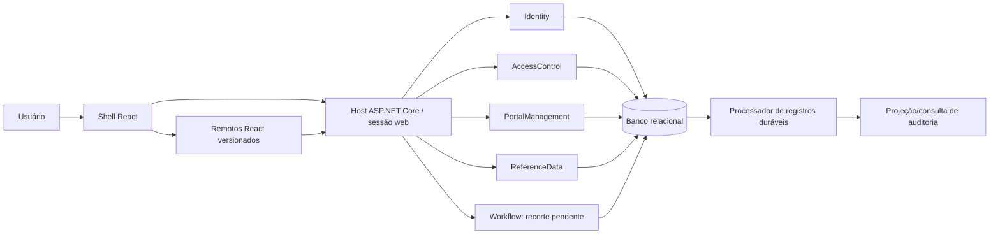

# Proposta arquitetural — .NET e React

Data: 2026-10-31. Estado: proposta para avaliação, não arquitetura aprovada. Base: regras vigentes e E39 (várias equipes com módulos independentes; propor implantação inicial simples). Sem código, provisionamento ou escolha definitiva de pacotes nesta etapa.

## Recomendação inicial

Backend como monólito modular ASP.NET Core; frontend como shell React e microfrontends com artefatos separados. Repositório único inicialmente, propriedade por módulo e contratos versionados. Uma implantação backend e um banco relacional com propriedade lógica dos dados por módulo; remotos publicados como artefatos estáticos versionados.

Independência de equipe exige limites verificáveis e processo de integração; não implica imediatamente processos de backend separados. Implantação conjunta exige coordenação de releases. A separação posterior de serviço será motivada por operação, escala, isolamento ou cadência, não apenas pelo nome do módulo.

| Alternativa | Vantagem | Custo/limite | Parecer inicial |
|---|---|---|---|
| Monólito sem limites de módulo | Poucos projetos | Acoplamento e disputas entre equipes | Não recomendado para esta organização |
| Monólito modular | Transações locais, operação inicial simples, limites por equipe | Release backend conjunta; fronteiras exigem verificação | Recomendado |
| Microserviços desde o início | Releases e falhas de processo independentes | Rede, consistência distribuída, implantação/observabilidade e identidade entre serviços | Adiar até necessidade demonstrada |

## Visão de componentes



Diagrama lógico: quantidade de processos de trabalho e destino da auditoria ainda a definir. Mesmo contexto JavaScript para shell/remotos é opção, não fronteira segura presumida.

## Limites de módulos backend

| Módulo | Responsabilidade | Não deve possuir |
|---|---|---|
| Identity | Conta única/CPF, credenciais ou integração IdP, MFA, sessões, perfil pessoal, recuperação | Regras de carteiras ou menus |
| AccessControl | Escritórios/vínculos de acesso, grupos/perfis, hierarquia, ações, limite delegável, perfil global e IP | Credenciais e cadastros de conteúdo de portais |
| PortalManagement | Portais, módulos, funcionalidades, menus, estados, remotos e versões | Decisão final de identidade ou escopo de recurso |
| ReferenceData | Cadastros básicos e regras específicas de importação | Permissões genéricas de todos os módulos |
| Audit | Eventos persistidos, projeção, consulta por escopo e retenção futura | Autorizar a operação de negócio por si só |
| Workflow | Execução nova e responsabilidades quando refinadas | Motor genérico escolhido antes de existir processo |

Propriedade mestre de escritórios/carteiras é uma decisão aberta: distinguir seus dados cadastrais dos vínculos de autorização. AccessControl pode possuir apenas IDs e vínculos se o cadastro mestre ficar em outro módulo/sistema. Não duplicar fontes mestres por conveniência.

## Organização interna

Combinar separação de domínio/aplicação/infraestrutura com funcionalidades verticais. Cada caso de uso agrupa contrato de entrada, validação, execução e saída. Domínio concentra invariantes reais; consultas podem projetar DTOs sem reconstruir agregados desnecessariamente.

Proposta: dois assemblies por módulo no início: `Module` e `Module.Contracts`. Dentro de `Module`, pastas `Domain`, `Features`, `Infrastructure` e `Endpoints`. Isso reduz projetos, mas não impõe Clean Architecture por compilação: testes de arquitetura devem impedir dependências indevidas entre pastas e módulos. Se forem necessárias barreiras de compilação mais fortes, separar Domain/Application/Infrastructure via ADR.

Módulos só referenciam contratos públicos de outros módulos. Não acessar DbContext, entidades internas ou tabelas alheias para escrever. Consultas entre módulos passam por contrato ou projeção específica. Não criar uma biblioteca compartilhada que reúna todas as entidades.

## Estrutura de pastas proposta

```text
recovery-backoffice/
  docs/
  src/
    backend/
      Recovery.Backoffice.slnx
      Directory.Build.props
      Directory.Packages.props
      Host/
        Recovery.Backoffice.Api/
          Program.cs
          Composition/
          Middleware/
      Platform/
        Recovery.Backoffice.Platform/
          Persistence/
          Observability/
          Messaging/
      Modules/
        Identity/
          Recovery.Backoffice.Identity.Contracts/
          Recovery.Backoffice.Identity/
            Domain/
            Features/
              Users/Create/
              Users/ChangeEmail/
              Sessions/SignIn/
            Infrastructure/
              Persistence/Configurations/
              Persistence/Migrations/
              Authentication/
            Endpoints/
            IdentityModule.cs
        AccessControl/           # mesmo formato, sem gerar módulos vazios
        PortalManagement/
        ReferenceData/
        Audit/
    frontend/
      apps/
        backoffice-shell/
        identity-remote/
        administration-remote/
        reference-data-remote/
      packages/
        portal-contracts/
        ui/
        api-client/
        tooling/
  tests/
    backend/{Unit,Integration,Architecture}/
    frontend/{contracts,e2e}/
  deploy/
  scripts/
```

Nomes e quantidade de remotos são candidatos. Cada remoto pode organizar `src/app`, `features`, `components` e `api`; componentes específicos ficam na funcionalidade. Workflow entra no código quando houver recorte, evitando estrutura vazia e dependências fictícias.

## Padrões e quando usar

| Padrão | Uso proposto | Limite |
|---|---|---|
| Vertical Slice | Organização por caso de uso | Não exige framework mediador |
| Clean Architecture pragmática | Domínio independente de HTTP/persistência | Verificar dependências, não apenas nomear pastas |
| DDD tático seletivo | Identidade, concessões e invariantes de hierarquia | Não criar agregados complexos para tabela de referência trivial |
| CQRS lógico | Comandos alteram; consultas projetam | Mesmo banco inicialmente; sem event sourcing |
| Policy/Specification | Regras compostas e reutilizáveis de autorização quando úteis | Não esconder todas as consultas em abstrações genéricas |
| Strategy/Adapter | Email, IdP, método MFA e integrações substituíveis | Interface apenas na fronteira que exige substituição |
| Transactional Outbox | Alteração sensível e evento durável na mesma transação | Projetar reentrega/idempotência; não prometer exactly-once |
| Concorrência otimista | Detectar edição desatualizada e devolver conflito | Não substitui locks/transações para invariantes concorrentes |
| Composition Root | Registrar módulos no host explicitamente | Evitar descoberta dinâmica de assemblies no MVP |

EF Core já oferece rastreamento e unidade de persistência. Não adicionar repositório genérico/UoW customizado obrigatório nem múltiplos mapeadores/mediadores sem benefício verificável. Repositório específico pode existir para agregados com regras relevantes.

## Identidade, sessão e autorização

Proposta web: mesma origem lógica para shell e API, cookie de sessão `Secure`/`HttpOnly`, proteção CSRF nas mutações e sessão autoritativa no servidor. Se houver IdP OIDC, tokens permanecem no backend em abordagem BFF. Não armazenar tokens de acesso em localStorage. Arquitetura BFF ainda é proposta e não resolve, sozinha, código remoto malicioso no navegador.

CPF de login, primeiro acesso com senha temporária e MFA precisam ser conciliados com o provedor antes de escolher implementação. Candidato sem IdP confirmado: ASP.NET Core Identity para credenciais, com fluxos próprios orquestrados para os requisitos. Não escrever hash, criptografia ou protocolo de autenticação próprio. Endpoints/tokens embutidos do Identity não devem ser presumidos como servidor OIDC completo.

Sessão única usa registro consistente por conta e substituição atômica sob concorrência. Contexto ativo deve ser validado pelo servidor; acesso amplo não elimina seleção de escritório. Definir sincronização de contexto entre abas. Senha válida antes de MFA/troca obrigatória dá somente autorização restrita, nunca sessão operacional completa.

Autorização proposta: pipeline com estado de conta/sessão, escritório elegível, IP, disponibilidade por portal, ação e escopo de recurso. Consultas de recursos aplicam escopo no servidor; detalhes da ordem serão especificados por fluxo para evitar exposição por mensagens. Exceção de auditoria agregada é explícita.

Permissões/IP podem ter atualização em até 1 minuto provisoriamente. Disponibilidade de módulo/funcionalidade não pode usar esse mesmo cache permissivo: novas requisições após salvar devem consultar estado consistente ou mecanismo equivalente com garantia verificável. Não aprovar cache local sem invalidação comprovada para PRT-008.

## Persistência e consistência

EF Core na mesma versão principal do .NET é candidato. Banco relacional único inicialmente, schemas e DbContext por módulo, migrações com proprietário e ordem controlada. SQL Server e SQL Server continuam em avaliação conforme padrões corporativos, provedor, custo e operação. Não manter suporte a vários bancos como requisito implícito.

Chaves e índices devem garantir unicidade do CPF normalizado e pares de vínculos. Um token de concorrência persistido atende CON-001; APIs devem devolver conflito sem gravar versão desatualizada. Tipo de token será escolhido após banco.

Evento de auditoria durável deve ser gravado na transação da alteração sensível. Evitar depender de chamada síncrona a um serviço remoto para durabilidade. Processador reenvia eventos com ID estável, tentativas e tratamento de falhas; destino deduplica. Auditoria não terá endpoints de edição/exclusão manual.

Importação cria somente, valida lote antes de persistir e rejeita lote inválido integralmente. A atomicidade de falha durante persistência é proposta a formalizar; limites de lote tornam essa garantia operável. Não executar trabalho longo em memória sem registro durável de estado quando houver retomada necessária.

## React e microfrontends

React + TypeScript como base proposta; bundler e composição comparados abaixo. Shell mantém sessão visível, escritório ativo, navegação, tema e estados de falha. Contrato versionado passa somente capacidades mínimas aos remotos; autorização final permanece na API.

| Candidato | Adequação | Decisão |
|---|---|---|
| Rspack/Rsbuild + Module Federation | Runtime remoto e compartilhamento de dependências | Candidato principal para prova de conceito |
| Vite + integração de federation | Experiência de desenvolvimento e alternativa de composição | Comparar compatibilidade de plugin/runtime |
| iframe com protocolo de mensagens | Isolamento de origem potencialmente mais forte | Comparar impacto em sessão, acessibilidade, tema e navegação |

Remotos de qualquer origem HTTPS são requisito aprovado; autoria Recovery não elimina risco de comprometimento do host do artefato. Antes de escolher composição no mesmo contexto JavaScript ou iframe, validar modelo de confiança e prova de conceito. CSP, CORS e controle de versão não equivalem a sandbox. Não executar consulta servidor a URL arbitrária sem proteção de destinos/redirecionamentos.

Router, formulários, cache de consultas, validação e biblioteca visual serão selecionados por compatibilidade, acessibilidade, licenças e tamanho; evitar lista de frameworks adotados antes da comparação. Pacote `ui` terá componentes/tokens; `portal-contracts` terá tipos públicos, sem lógica de negócio nem estado global compartilhado de todos os módulos.

## Trabalho de várias equipes

Definir responsável por módulo, revisão de contratos, regras de dependência, convenções e compatibilidade shell/remoto. Contratos OpenAPI geram clientes quando conveniente. Mudanças incompatíveis exigem transição/versionamento; backend modular não torna deploy independente automaticamente.

CI proposta: build/testes por caminho alterado mais validação integrada antes do merge; testes de arquitetura, autorização por escopo/IP, concorrência de sessões e edições, persistência durável de auditoria e contratos de remotos. Segredos/configuração por ambiente, migrações executadas de forma controlada, não por cada réplica ao iniciar.

Backend modular pode começar com worker no mesmo processo somente se tarefas forem duráveis e não dependerem de memória; parada/ociosidade do host afeta latência. Separar worker quando houver requisito de operação independente. Não assumir que hospedagem gratuita sustenta processamento contínuo.

## Frameworks: posição inicial

| Componente | Proposta | Estado |
|---|---|---|
| Runtime | .NET 10 LTS / ASP.NET Core | Recomendado pela janela de suporte; patch a verificar ao iniciar |
| Persistência | EF Core 10 | Candidato; validar provedor e transações |
| Frontend | React, TypeScript | Proposta; fixar versões compatíveis na prova de conceito |
| Composição | Rspack/Rsbuild e Module Federation versus isolamento por iframe | Avaliação necessária |
| Identidade | IdP corporativo OIDC ou ASP.NET Core Identity | Aberto; não escolher silenciosamente |
| Telemetria | Logs estruturados, correlação e métricas; avaliar OpenTelemetry | Padrão desejado, pacote/exportador abertos |
| Testes | Testes .NET, integração com banco real escolhido, contratos frontend e E2E | Ferramentas e versões abertas |

## Próximos ADRs e provas de conceito

1. Monólito modular, limites/propriedade e organização de assemblies.
2. Identidade e sessão: login CPF, senha temporária, MFA, sessão única e revogação.
3. Confiança e composição de remotos, contrato e retorno de versão.
4. Banco, migrações, concorrência e auditoria durável.
5. CI/CD, hospedagem de homologação e orçamento.

Não gerar solução antes de resolver pelo menos as bases 1–3 ou registrar premissas explícitas. Documentar e implementar cada decisão dentro da autorização de desenvolvimento, sem confundir proposta com aprovação corporativa.

## Fontes oficiais consultadas

Consulta em 2026-10-31. Arquitetura é recomendação contextual, não uma determinação das fontes.

- [.NET: política de suporte](https://dotnet.microsoft.com/en-us/platform/support/policy/dotnet-core): .NET 10 listado como LTS ativo.
- [Microsoft: arquiteturas de aplicações web](https://learn.microsoft.com/en-us/dotnet/architecture/modern-web-apps-azure/common-web-application-architectures): implantação e separação lógica.
- [Identity para SPAs](https://learn.microsoft.com/en-us/aspnet/core/security/authentication/identity-api-authorization): cookies/tokens e limites do serviço embutido.
- [EF Core: persistência](https://learn.microsoft.com/en-us/ef/core/saving/) e [concorrência](https://learn.microsoft.com/en-us/ef/core/saving/concurrency): transações e conflitos.
- [React: versões](https://react.dev/versions).
- [Vite: introdução](https://vite.dev/guide/).
- [Rspack: Module Federation](https://rspack.dev/guide/advanced/module-federation).
- [Module Federation: runtime](https://module-federation.io/guide/runtime/).
